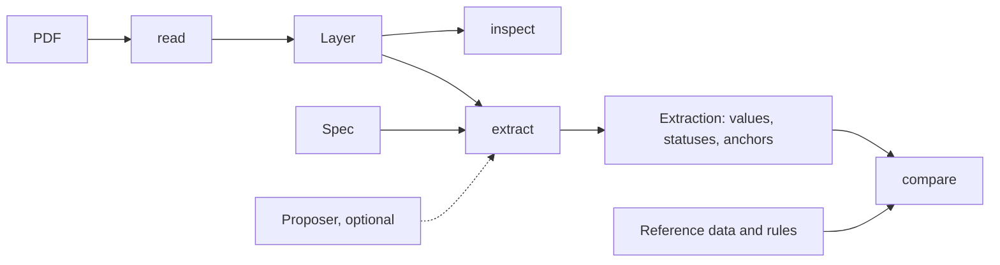

# Janus design

Janus reads PDFs and extracts typed values with evidence. Each value comes with the place where it
is printed, so a person or a program can check it against the page. Janus has three parts:

- `janus-pdf`, a Python library with no web framework. Other programs, Kittum among them, import
  it.
- `janus`, a command-line program in the same package.
- The workbench, a small web app on top of the library. It writes specs and shows evidence.

The core is deterministic. A language model, a vision model or Docling can propose a value for a
field that the deterministic layer cannot find. Janus accepts a proposal only when it finds the
proposed text on the page and that text parses to the proposed value.



## Package layout

```text
packages/janus/                 distribution janus-pdf, import name janus_pdf
  src/janus_pdf/
    __init__.py                 the public interface below, and nothing else
    document/                   PDF to Layer: the document model, engines, anchors
      model.py                  Layer, Page, Word, Line, Table, TableCell, Box, Anchor
      engines.py                PyMuPDFParser, PdfiumParser
      layout.py                 words to lines, blocks and reading order
      tables.py                 ruled-table detection and cell text
      triage.py                 which pages have usable text (pdf-inspector, optional)
      docling.py                DoclingParser (optional extra)
      ocr.py                    OcrMyPdfParser (needs the ocrmypdf command)
      anchors.py, quotes.py     anchors, quote search, re-anchoring
      render.py                 page images that boxes fit over
    values.py                   value types and strict parsing
    spec.py                     the spec format: load and validate
    _index.py                   per-layer index: label matching, headings, suggestions
    _locate.py                  the five locators, records included
    extract.py                  the extracted rule, the proposer seam, extract()
    compare.py                  the comparator
    inspect.py                  the inspect view, as data
    output.py                   text and JSON output for the CLI
    cli.py                      janus inspect | extract | compare
    canonical.py                RFC 8785 canonical JSON for hashes
  tests/                        fixtures/make_fixtures.py builds the test PDFs
  scripts/benchmark.py          timings on a generated 100-page document
apps/workbench/                 FastAPI server and React client; depends on janus-pdf only
```

The library depends on pydantic, PyMuPDF, pypdfium2, rapidfuzz and PyYAML. Docling,
pdf-inspector and OCR are optional. Janus never imports Kittum.

## Public interface

```python
import janus_pdf

layer = janus_pdf.read(path_or_bytes, parser=janus_pdf.PyMuPDFParser())  # open
view = janus_pdf.inspect(layer, page=None, find=None, rows=3)              # inspect
spec = janus_pdf.load_spec(path_or_text_or_dict)                           # raises SpecError
ex = janus_pdf.extract(layer, spec, proposer=None)                         # extract
checks = janus_pdf.compare(ex, reference, rules={})                        # compare
```

- `read` returns a `Layer`. A layer is immutable and content-addressed: its `id` is a hash of
  the PDF's hash, the parser's recipe and everything the parser read. The same PDF and the same
  parser always give the same layer, and two files that read alike, or one file read by two
  recipes, never share an id. Anchors, extractions and inspections name their layer by this id.
- `read` refuses a file it cannot read completely, with an `UnreadablePdf`: `NotAPdf` for bytes
  that are not a PDF or will not open, `EncryptedPdf` for a PDF that needs a password, and
  `EmptyPdf` for a PDF with no pages. A PDF encrypted only against editing opens without a
  password and reads normally.
- `inspect` returns an `Inspection`: pages, tables with their first rows, headings, and every
  place a phrase is printed. It tells a spec author what each locator will see.
- `extract` returns an `Extraction`. `ex.data` is the nested output: a field that is not
  extracted is `None`. `ex.fields` holds one `FieldResult` per field, with its status, value,
  type, printed text, anchors, method, message, candidates and suggestions. `ex.result(path)`
  returns one result. A value printed in one run of words has one anchor; a value whose words
  have other words between them, such as a description wrapped under a quantity, has one
  anchor for each run.
- `compare` returns a list of `Check`. Each check has a path, a status, the expected and actual
  values, a message and an anchor.
- `janus_pdf.resolve(anchor, layer)` finds an anchor again in another layer of the same document.
  `janus_pdf.render_png(pdf, page, scale)` renders a page image; boxes times `scale` fit over it.

The library writes no files, starts no threads and keeps no global state, except caches of the
most recent layer's lookups and index. Each cache is one immutable value replaced in a single
assignment, so threads that read different layers at worst rebuild it. It needs no reference
data and no server.

## The document model

A `Layer` holds the whole document as one string, `text`, and typed views into that string:

- `pages`, `words`, `lines`, `blocks`, `tables` and `cells`. Each has `start` and `end` offsets
  into `text`, and words, lines and cells also have boxes in PDF points. Boxes are on the page
  as displayed, after its `/Rotate`, measured from the top-left corner, so they lie over the
  image `render_png` draws. `Page.width` and `Page.height` are the displayed size. Words read in
  the direction the text runs, which `Page.frame` gives as the turn from the displayed page.
- Separators in `text` show the structure: a space between words, `\n` between lines, `\n\n`
  between blocks, `\t` between cells, `\n` between table rows and `\n\f\n` between pages.
- A `Line` has `size`, the largest font size on the line in points, and `bold`, which is true when
  every word on the line is bold. Janus finds headings with these two values. Box heights do not
  track font size closely enough.
- A `TableCell` has its row, column, spans, a `role` and `header_path`: the header cells above
  it, from the top. Nested headers give paths like `("Site B", "n = 355")`. The role is `title`,
  `header` or `body`. A title is a leading row whose one cell spans the whole table, such as
  "Purchase order PO-7731" over the column headers; it heads no column. The header starts at the
  first row after any titles. So `cell`, `label` with `column`, and `records` all see the same
  header row.

### Table cells

In a fully ruled table the rules decide the cells. PyMuPDF's `find_tables` gives the cell boxes
the rules enclose, and Janus takes the grid from them, merged cells included; the words only fill
the cells. A ruled table with a caption is still read from its rules.

A three-rule table, found from its "Table N" caption and the rules under it, gets its grid from
its words. Columns are the x-ranges that most rows leave empty, and each boundary sits where the
fewest words reach into that range. In the body every word belongs to the column under its
centre, so a row label wider than its column, like "Taxa per sample, mean (SD)", stays one cell
beside its value. A header phrase spans the columns it crosses up to the column where the next
phrase in its row starts.

An `Anchor` points at a stretch of text. It holds the offsets, a quote with context, one box per
printed line, the table cells, the document hash and the layer id. `resolve` re-finds the quote in
a new layer by exact match, then by context, then by a fuzzy match of at least 90 for quotes of
20 characters or more. It reports `exact`, `candidate`, `ambiguous` or `unresolved`.

### Engines

An engine turns one PDF page into words, boxes, font sizes and ruled tables. The layout code
turns those into lines, blocks and reading order. The engines are:

| Engine           | Use                                     | Font sizes                   | Tables           |
| ---------------- | --------------------------------------- | ---------------------------- | ---------------- |
| `PyMuPDFParser`  | Default for documents with a text layer | Yes                          | Ruled tables     |
| `PdfiumParser`   | Second opinion; about twice as fast     | Yes                          | No               |
| `DoclingParser`  | Tables without rules, complex layouts   | From PyMuPDF                 | Docling's tables |
| `OcrMyPdfParser` | Scanned pages                           | From PyMuPDF on the OCR text | Ruled tables     |

Docling and OCR plug in at the page level. `DoclingParser` keeps PyMuPDF's words and replaces
the tables with Docling's table regions and grids. `OcrMyPdfParser` runs `ocrmypdf` to add a text
layer and then reads the result with PyMuPDF. `triage` decides per page whether the text layer is
usable. A parser's recipe records its name, version, settings and model weights hash, so layers
from different engines never share a hash.

PyMuPDF gives each span's size and flags. PDFium gives each character's `Tf` size, which Janus
scales by the character's text matrix, because many producers set `Tf 1` and scale with the
matrix. Bold comes from the font weight, the ForceBold flag or the font name, in that order, as
PyMuPDF decides it. On the test report and on a 10-page journal article the two engines agree on
every heading's size and weight.

`ASSEMBLY_VERSION` names the layout algorithm and is part of every recipe. Bump it when layout
output changes. The current version, `janus.layout.v4`, gives boxes on the page as displayed and
cell roles; `layout.v3` added font size and weight to lines. `TABLES_VERSION` names the table
grid rules the same way. Layer ids change with either. The recipe also names what triage ran: with the `triage` extra it records
the pdf-inspector version, and without it only the PyMuPDF check, so the two never share a hash.

## The spec format

A spec is YAML or JSON. It names fields, says where each field is printed, and says what type
each value has. A person can read and write it by hand.

```yaml
name: Supplier invoice
fields:
  number: { label: Invoice number }
  issued: { label: Invoice date, type: date }
  due: { label: Due date, type: date DD/MM/YYYY }
  total: { label: Amount due, type: "money EUR 1.234,56" }
  shipping:
    fields:
      method: { label: Ship via }
      weight: { label: Gross weight, type: decimal }
  items:
    records:
      header: { code: Code, qty: Qty, amount: Amount }
      stop: [Subtotal]
    columns: { qty: integer, amount: "money EUR 1.234,56" }
  terms: { section: Payment terms, under: Conditions }
  stamp: { region: { page: 1, box: [400, 40, 560, 90] } }
  rate_b: { cell: { table: p2t0, row: 4, column: 2 }, type: percent }
```

Quote a type that contains a comma inside `{…}`, because YAML splits a flow mapping at commas.
A group holds its own `fields:`, and its fields get paths like `shipping/method`. Record cells
have paths like `items/2/qty`.

The spec is checked when it loads, against a pydantic model of every key, so a malformed spec
cannot reach a locator. Every failure is a `SpecError` that names the field and the key:
`items: records.header: expected a mapping of keys to printed headers, not ['Qty']`. It is raised
for an unknown key, a field with no locator or two, a value of the wrong kind for any key
(`cell: 3`, `fields: null`, `label: 123`), a bad type, and a spec that contradicts itself, such
as a `region` page or a numbered `cell` table outside the field's `pages`, or a `filled` key that
is not one of the header's keys.

### Locators

Each field has exactly one locator:

- `label: Text` reads the value printed after a label. `label: [Text, Other text]` accepts several
  names. In a table, add `column: Header` to read the cell in that column on the label's row. The
  column must equal one of the headers in the cell's header path.
- `cell: {table, row, column}` reads one cell. `table` is a table ID from `inspect` or a number
  counting the tables on the field's pages from 1. `row` is a row number or a row label, and
  `column` a column number or a header. A merged cell is read where it covers the row and the
  column; an empty cell is `missing` with "is empty".
- `records: {header, stop, filled}` reads a table as a list of objects. See "Records" below.
- `section: Heading` reads the text under a heading up to the next heading of the same or higher
  rank. `under: Parent` picks one heading when the document uses the same heading twice. When the
  same heading is printed twice under the same parent, `under:` cannot tell them apart, and the
  message says to narrow the field with `pages:` or to take the text with a `region`.
- `region: {page, box}` reads exactly the words inside a box, in PDF points from the top left of
  the page as displayed, in reading order. A word is inside when the centre of its box is: a word
  that straddles the edge belongs to the region that holds more than half of it, so two regions
  that share an edge never both take it, and a box drawn past the edge of the page takes what is
  printed up to the edge.

`pages: 3` or `pages: 3-5` limits a field to those pages. It applies in one place: every
locator, and the confirmation of a proposal, reads the layer through a view of the field's pages,
so words, tables, headings, label matches and suggestions on other pages do not exist for that
field.

### Records

`header` maps output keys to printed headers. The header can be any row of a ruled table, or a
printed row of words when the table has no rules; in a table without rules each column spans its
header's width. Each row becomes an object whose cells are the exact words in each column, and
each record keeps the page it is printed on.

Rows end at a row whose first printed text begins with a `stop` label, on a word boundary, or
at the end of the table; in a table without rules, a gap of more than 2.2 line heights also ends
them. Carried and brought forward lines
("Carried forward", "Balance brought forward", "c/f", "continued") are left out, and so are
running heads, running feet and page numbers. Janus counts a line as furniture when an adjacent
page prints the same text, digits aside, at the same height, and it is not in a table cell.

Records follow a table onto the next page only when the continuation is certain:

1. the rows run to the foot of their page, with nothing below them but furniture and continued
   lines;
2. the next page is on the field's pages; and
3. that page opens, after furniture and continued lines only, with the same header printed
   again, or with a table whose column edges match within 1.5 points. For rows without rules,
   the second case is a first line aligned with the header's columns, edge to edge within 1.5
   points, in at least two columns. In a ruled table title rows above the repeated header are
   skipped.

When the rows run to the foot of a page and the next page does not certainly continue them, the
field is `incomplete`, with no value. The message gives what was found and why the list may go
on: "40 rows under the header on page 1; the rows run to the foot of page 1, and page 2 neither
repeats the header nor starts with a row under the same columns; if the rows end on page 1, say
so with `pages:` or a `stop:` label". When the field's last page
ends with a carried-forward line, the rows go on outside the field's pages, and the field is also
`incomplete`.

In a table without rules a record can wrap. A line that fills only some of the columns the
record's first line fills is a wrapped line of that record when it is set closer to the line
above than records are to one another: at most three quarters of the smallest spacing between
lines that certainly start records. Its words join that record's cells, and their boxes join
those cells' anchors. A line the spacing does not settle, and a short line at the top of a page,
makes the field `ambiguous`, and the message names the line, the record above, and the remedy:
`filled: qty` says that a line with nothing in the `qty` column continues the record above. A
ruled table's rows follow its grid and never wrap.

`filled` is the one key records adds for this. A gap rule cannot settle a line set at the record
spacing, and naming the column that every record fills is something the spec author can read off
the page.

### How a label matches

Janus normalizes labels and page text in the same way: NFKC, case folding, single spaces, one
kind of dash, and no trailing colon. Then:

1. The label must begin a printed line or a table cell and end at a word boundary. "Total" does
   not match the middle of "Grand total".
2. In a table, the label must equal the whole cell. A label that is only the start of a cell, like
   "Length" for "Length, mm, mean ± SD", gives a suggestion, not a value.
3. Outside a table, the value is the rest of the line. If the rest of the line is empty, the value
   is the words to the right on the same visual row, then the next line.
4. A value on the label's own line must be set off from the label by a separator or by a gap
   wider than 0.8 times the line height. Without one, a text field gets a suggestion and no
   value. "Due" in "Due date 11 April 2026" therefore never returns "date 11 April 2026". The
   separator is a colon, or a hyphen, en dash or em dash with a space or the line end after it.
   The label locator drops the separator and nothing else, so "Amount: -123" and "Amount -123"
   read -123 and "Amount - 8" reads 8. No other locator drops anything: a cell or a region that
   prints "-12" reads -12.
5. Janus uses fuzzy matching only when nothing matches. It scores the opening words of each line
   and cell with rapidfuzz and returns up to three suggestions of 75 or more. A suggestion is
   never a value.

### Value types

A type is a short string or a mapping:

```yaml
type: date DD/MM/YYYY
type: money EUR 1.234,56
type: count_percent count # read "12 (34.5%)", keep 12
type: { kind: date, formats: ["D. MMMM YYYY"], locale: de }
type: { kind: integer, absent: ["NR", "n/a", "—"] }
```

| Kind                | Printed                                            | Value                                                    |
| ------------------- | -------------------------------------------------- | -------------------------------------------------------- |
| `text`              | `Blue Fern Studio`                                 | `"Blue Fern Studio"`                                     |
| `integer`           | `1,234`                                            | `1234`                                                   |
| `decimal`           | `1.234,56` with `1.234,56`                         | `"1234.56"`                                              |
| `percent`           | `41.1%`                                            | `"41.1"`                                                 |
| `percent any`       | `-2.5%` or `150%`                                  | `"-2.5"` or `"150"`                                      |
| `date`              | `12 March 2026`, or `11/04/2026` with `DD/MM/YYYY` | `"2026-03-12"`                                           |
| `money`             | `£627.00`                                          | `{"amount": "627.00", "currency": "GBP"}`                |
| `count_percent`     | `12 (34.5%)`                                       | `{"count": 12, "percent": "34.5"}`                       |
| `mean_sd`           | `46.2 ± 14.7` or `46.2 (14.7)`                     | `{"mean": "46.2", "sd": "14.7"}`                         |
| `estimate_interval` | `1.42 (1.10 to 1.83)`                              | `{"estimate": "1.42", "lower": "1.10", "upper": "1.83"}` |
| `p_value`           | `P < 0.001`                                        | `{"comparator": "<", "value": "0.001"}`                  |

A compound kind followed by a part name keeps only that part.

Parsing is strict. The whole printed text must parse, or the field is `invalid`. Decimals are
strings, so `"627.00"` keeps its printed precision and no float rounding can occur. Dates are ISO
strings. Other rules:

- The number format is a sample: `1,234.56`, `1.234,56`, `1 234,56` or `1234.56`.
- A numeric date needs a declared format, because the page does not say whether `11/04/2026` is
  in April or November.
- `$` needs a declared currency, because many currencies use it. A printed currency that differs
  from the declared one is an error.
- A number may carry a sign: a hyphen-minus, the minus sign U+2212 or a plus. A number in
  parentheses, such as `(123)` or `(£40.00)`, is negative, and the result says so in a note.
- `percent` is a share: a number from 0 to 100, as in "41.1% of patients".
  `percent any` is a change or a rate that can take a sign and any size, as in "-2.5%" or
  "+150%". A share outside 0 to 100 is `invalid`, and the message suggests `percent any`. In a
  mapping, `bounds: share` or `bounds: any` says the same.
- Janus checks what it can: an estimate must lie inside its interval, a p-value must lie between
  0 and 1, and a standard deviation must not be negative.
- `absent` lists printed markers that mean "no value". The default is `NR`, `N/A`, `not reported`
  and a lone dash. A marker gives an extracted `None` with a note.

## Statuses and evidence

Each field result has one status:

| Status        | Meaning                                                              |
| ------------- | -------------------------------------------------------------------- |
| `extracted`   | The value meets the extracted rule.                                  |
| `missing`     | The locator found nothing. Suggestions may follow.                   |
| `ambiguous`   | The locator found several places that disagree. Each is a candidate. |
| `incomplete`  | Records that may go on where the page cannot show they do.           |
| `invalid`     | The locator found text, and the text does not parse as the type.     |
| `unconfirmed` | A proposer gave a value, and Janus could not confirm it on the page. |

The extracted rule: a field is `extracted` only when all three of these are true:

1. The locator found one place, or several places that print the same value.
2. The whole printed text at that place parses as the field's type.
3. Janus can make anchors, with at least one box, for exactly the words of that text.

"The same value" is decided by the field's type. Numbers are the same when they are equal as
numbers, so "4.60" and "4.6" agree in a decimal field. Text is the same only when it is equal
after spacing, so a text field printed `Code: 001` in one place and `Code: 1` in another is
`ambiguous`. Dates, money and compound values compare part by part in the same way.

`ambiguous` also covers a printed line that could belong to two records. A records field that is
`ambiguous` or `incomplete` keeps no rows: a partial list is never presented as the whole.

Every other result has a value of `None`. `ex.data` therefore contains only values that meet the
rule. A program that reads `ex.data` cannot get an unchecked value by mistake.

Messages tell the author what to change: "2 places disagree: p3 …, p4 …; say which with
`under:` 'Methods' or 'Results'", or "'11/04/2026' is a numeric date; declare its format, such as
DD/MM/YYYY or MM/DD/YYYY".

## The proposer seam

```python
class Proposer(Protocol):
    name: str
    def propose(self, layer: Layer, field: Field, result: FieldResult) -> Proposal | None: ...

@dataclass(frozen=True)
class Proposal:
    value: Any               # what the proposer thinks the value is
    quote: str               # the printed text it read the value from
    context: str = ""        # nearby printed text, to choose between repeated quotes
    page: int | None = None
    note: str = ""
```

`extract` asks the proposer only about fields that are not extracted, and passes it the failed
result. Janus confirms a proposal in this order:

1. It searches for `quote` on the field's pages, by whole tokens. The search must give exactly
   one place. If the quote is printed more than once, `context` and `page` must narrow it to one.
2. The quote must parse, whole, as the field's type.
3. The parsed value must be the same value as the proposal, by the type's equality. For a text
   field that means the printed text itself: a proposal of "1" with the quote "001" is
   unconfirmed.

A confirmed proposal is `extracted`, with method `proposed:<name>` and an anchor. Any other
proposal is `unconfirmed`. Its value stays out of `ex.data`, and the message gives the reason
and the status before the proposal. In the tests, a proposal for a VAT amount under a wrong label
is confirmed. A numeric date with no declared format, an invented order number and a misquoted
customer name stay unconfirmed.

A proposer needs three things from Janus: the layer text or page images, the field's path, type
and locator, and the failed result with its suggestions. It must return the printed quote, not
only the value. A proposer can be a language model given the page text, a vision model given
`render_png` images, or Docling's key-value output. Janus ships no proposer. The workbench and
Kittum supply their own.

## The comparator

`compare(extraction, reference, rules)` checks reference data against an extraction. It does not
read the PDF.

- The comparator walks every leaf of the reference and looks at the same path in `ex.data`.
  Reference data can leave out fields.
- `rules` maps path patterns (`fnmatch`, like `items/*/amount`) to `tolerance` (absolute),
  `relative`, or `text: exact | casefold | spacing`.
- Values compare by the type of the field that holds them, the same equality the extracted rule
  uses. A numeric part compares as a number, with the rule's tolerance, and a reference that is
  not a number is a mismatch. A text field compares as text, so one that prints `0451` is never
  equal to the number 451.
- Statuses: `match`, `mismatch` and `not_extracted`. A reference path that the spec does not
  have, or a field whose status is not `extracted`, gives `not_extracted`, and the message says
  which field and its status. It is never a match. Each check carries the field's anchors.

## What Kittum imports

Kittum depends on `janus-pdf` and imports from `janus_pdf` and `janus_pdf.document`. Kittum
already depends on the old Janus server, whose import name is `janus`; the new import name keeps
the two apart.

- The model: `Layer`, `Page`, `Word`, `Line`, `Table`, `TableCell`, `Box`, `Anchor`, `CellRef`,
  `RawLayer`, `ParserRecipe`.
- Parsing: `PyMuPDFParser`, `PdfiumParser`, `DoclingParser`, `OcrMyPdfParser`, `triage`,
  `recipe_hash`, `document_hash`, `layer_id`, `UnreadablePdf`, `NotAPdf`, `EncryptedPdf`,
  `EmptyPdf`.
- Anchors: `make_anchor`, `quote_spans`, `resolve`, `compare_layers`, `page_words`, `boxes_for`.
- Pages: `render_png`.
- Extraction: `load_spec`, `extract`, `Proposal`, `Proposer`, `compare`.

Kittum keeps what needs its database or the network: `store.py` (`ingest`, `derive`,
`get_document`, `get_layer`, `get_anchor`, `save_anchor`) and `acquisition.py`. Both call Janus
for the PDF work. Kittum's language-model extraction becomes a `Proposer`, so every value it
reports is confirmed against the page.

Layer and anchor JSON stays compatible, with one exception: `layout.v3` changes layer hashes.
Kittum re-derives stored layers when it first reads one with an old recipe. Anchors survive
through `resolve`.

### Migration order

1. Janus releases `janus-pdf` with the document layer, values, spec, extract, compare and the CLI.
   Its tests include the ported document tests.
2. A Kittum pull request adds the dependency, deletes `src/kittum/documents/` except `store.py`
   and `acquisition.py`, deletes `extraction/janus_path.py`, and changes imports. Kittum's
   document tests run against Janus.
3. Janus deletes the old engine and apps after the workbench runs on `janus-pdf`.

## The workbench

The workbench is a FastAPI server and a React client. It has no extraction logic of its own: each
endpoint calls one library function. It stores documents, layers, specs and runs on disk under
`JANUS_DATA_DIR`, keyed by hash.

Screens:

- **Documents.** Upload or drop PDFs. Each row shows pages, engine, tables found and read time.
- **Inspect.** Page images with words, lines, headings and tables drawn on them. Each table
  shows its ID and first rows. A search box shows every place a phrase is printed, and whether
  it begins a line or a cell, because a label must.
- **Spec editor.** The YAML on the left. The page and the results on the right. Each edit runs
  `extract` on the open document after 300 ms without typing. The library reuses the layer and
  its index, so a spec on 100 pages takes under 100 ms. Each field shows its status, value and
  message, and clicking it shows its anchor boxes on the page. Load errors appear on their line.
- **Click to locate.** Click a word on the page and the editor proposes locators for it: `label`
  when a label is printed before it, `cell` and `label` with `column` in a table, `records` for a
  table header, and `region` as a last choice. The author picks one, and the preview runs.
- **Runs.** One spec over many documents, a row per document and a column per field. Long
  documents and big batches show progress per page while the server reads them. Reading runs in
  a worker process. The client polls one status endpoint, and a read that stops can restart
  because each page's output is cached by hash.
- **Compare.** Upload reference data and rules. Each check links to its anchor.

## The CLI

```bash
janus inspect FILE.pdf [--page N] [--find TEXT] [--rows N]
janus extract SPEC FILE.pdf [--cells]
janus compare SPEC FILE.pdf REFERENCE [--rules RULES]
```

`--engine pymupdf|pdfium` chooses the engine. `--json` prints JSON. `extract` exits with 0 when
every field is extracted. `compare` exits with 0 when every check matches. Both exit with 1
otherwise, and with 2 for bad input. The text output gives one line per field: status, path,
page, value, then the message and suggestions on the next lines.

## Performance

| Step                                     | Target            | Measured in the spike                                        |
| ---------------------------------------- | ----------------- | ------------------------------------------------------------ |
| Read, PyMuPDF, born-digital              | ≤ 0.25 s per page | 0.15–0.19 s per page (10 pages); 0.20 s per page (100 pages) |
| Read, PDFium                             | ≤ 0.1 s per page  | 0.07 s per page                                              |
| Build the index, 100 pages               | ≤ 0.5 s           | 0.39 s                                                       |
| Extract one spec, 100 pages, first spec  | ≤ 0.5 s           | 0.34 s                                                       |
| Extract one spec, 100 pages, later specs | ≤ 100 ms          | 46 ms                                                        |
| Extract one spec, 1–10 pages             | ≤ 200 ms          | 7–165 ms                                                     |

The old engine took 13.6–18.1 s to read and extract the 10-page article.

`scripts/benchmark.py` measures these steps on a generated 100-page document and prints them
beside the targets. `pytest -m benchmark` runs the same steps as tests that fail at twice the
target. The default suite deselects them, because wall-clock times on a shared CI runner or a
busy laptop say little. The default suite guards against algorithmic regressions instead: it
asserts that several extractions on one layer build its index once. Read time depends mostly on
PyMuPDF. Layout assembly and hashing take about 40% of it, and that share is the place to
optimize first.

## Out of scope

- Writing to PDFs, filling forms and redaction.
- Handwriting recognition, and OCR other than through `ocrmypdf`.
- A built-in language-model proposer, prompts or model routing.
- Learning specs from examples. Click to locate proposes locators, and a person chooses them.
- Review workflows, reviewer decisions and comparison reviews. These go with the old app.
- A database. The library keeps nothing, and the workbench uses files.
- Identity of records across runs. `items/2` is the third row in document order, nothing more.
- Kittum-specific storage, acquisition and schemas.
